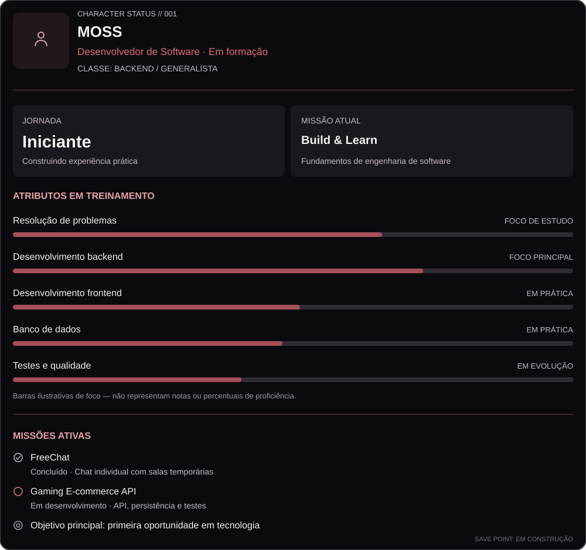

<div align="center">



</div>

## Sobre mim

Sou desenvolvedor em formação e uso projetos pessoais para transformar estudo em prática, aprender a tomar decisões técnicas e fortalecer meus fundamentos de engenharia de software. Tenho interesse em desenvolvimento de aplicações, APIs, bancos de dados e resolução de problemas.

## Inventário técnico

**Linguagens:** Python · JavaScript · Java · C

**Frameworks e ferramentas:** FastAPI · Django · React · PostgreSQL · Git

*Tecnologias com as quais tenho trabalhado ou estudado; a experiência varia conforme a ferramenta e o projeto.*

## Registro de missões

### ✅ FreeChat

Aplicação web de chat individual com fluxo de anfitrião e convidado, nomes temporários e salas acessadas por código. Projetada para conversas temporárias, sem histórico persistente.

**Explorar:** comunicação entre frontend e backend, fluxo de salas e ciclo de vida de uma sessão.

[Ver repositório do FreeChat](https://github.com/SEU-USUARIO/FreeChat)

### ⚙️ Gaming E-commerce API

API de e-commerce voltada ao universo gamer, construída como projeto de estudo de engenharia de software. O desenvolvimento inclui catálogo de produtos, persistência, testes e evolução gradual das regras de negócio.

**Explorar:** desenho de endpoints, modelagem de dados, testes automatizados e controle de acesso conforme as funcionalidades forem implementadas.

[Ver repositório da API](https://github.com/SEU-USUARIO/SEU-REPOSITORIO-DA-API)

## Árvore de habilidades

```text
DESENVOLVIMENTO
├── Python
│   ├── FastAPI
│   └── Django
├── JavaScript
│   └── React
├── Java
├── C
└── Banco de dados
    └── PostgreSQL

PRÓXIMAS MISSÕES
├── Aprofundar testes e qualidade
├── Consolidar fundamentos de backend
└── Evoluir projetos com decisões bem justificadas
```

## Conectar

- [GitHub](https://github.com/SEU-USUARIO)
- [LinkedIn](https://www.linkedin.com/in/SEU-LINKEDIN/)

---

<div align="center">
  <sub><code>FIM DO REGISTRO · SAVE POINT: EM CONSTRUÇÃO</code></sub>
</div>
