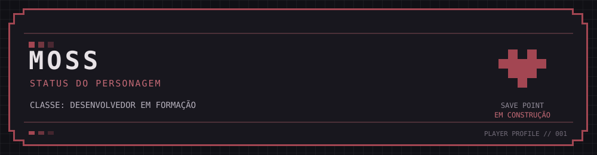

<!--
  README de perfil — Moss
  Para publicar: crie um repositório público com o mesmo nome do seu usuário GitHub
  e copie este arquivo e a pasta assets/ para a raiz dele.
-->

<div align="center">
  

  <p><strong>Desenvolvedor em formação · Construindo, testando e aprendendo um projeto por vez.</strong></p>

  <p>
    <a href="https://github.com/SEU-USUARIO"></a>
    <a href="https://www.linkedin.com/in/SEU-LINKEDIN/"></a>
  </p>
</div>

---

## `01` — Janela de status

> **Classe:** Desenvolvedor de Software em formação  
> **Missão principal:** conquistar minha primeira oportunidade na área de tecnologia  
> **Estilo de jogo:** aprender construindo, testar as decisões e entender o porquê de cada implementação.

Tenho interesse em desenvolvimento de software, especialmente na construção de aplicações, APIs e na resolução de problemas. Uso projetos pessoais para transformar teoria em prática e evoluir meus fundamentos de engenharia de software.

## `02` — Atributos em treinamento

As barras são **elementos visuais de estilo**, não notas de proficiência nem percentuais. O texto ao lado indica o foco de cada área; os repositórios mostram o que já foi colocado em prática.

| Atributo | Indicador de foco |
|:--|:--|
| `BACKEND` | `▰ ▰ ▰ ▰` — foco principal de estudo e projeto |
| `DATABASE` | `▰ ▰ ▰ ▰` — modelagem e persistência em prática |
| `TESTING` | `▰ ▰ ▰ ▰` — testes e validação em evolução |
| `FRONTEND` | `▰ ▰ ▰ ▰` — interfaces e integração com APIs |
| `PROBLEM SOLVING` | `▰ ▰ ▰ ▰` — algoritmos, depuração e resolução de problemas |

### Inventário técnico

**Linguagens**
- Python
- JavaScript
- Java
- C

**Frameworks e ferramentas**
- FastAPI
- Django
- React
- PostgreSQL
- Git e GitHub

> Lista de tecnologias com as quais tenho trabalhado ou estudado. O nível de experiência varia conforme a tecnologia e o projeto.

## `03` — Registro de missões

### ✅ FreeChat
Aplicação web de chat individual com fluxo de anfitrião e convidado, nomes temporários e salas acessadas por código. O projeto foi pensado para conversas temporárias, sem histórico persistente.

**O que explorar:** fluxo de comunicação, organização entre frontend e backend e ciclo de vida de uma sala.

<!-- Substitua pelo link real do repositório. -->
[Ver repositório do FreeChat](https://github.com/SEU-USUARIO/FreeChat)

### ⚙️ Gaming E-commerce API
API de e-commerce voltada ao universo gamer, desenvolvida como projeto de estudo de engenharia de software. O trabalho envolve catálogo de produtos, persistência, testes e evolução gradual das regras de negócio.

**O que explorar:** desenho de endpoints, modelagem de dados, testes automatizados e controle de acesso conforme as funcionalidades forem implementadas.

<!-- Substitua pelo link real do repositório. -->
[Ver repositório da API](https://github.com/SEU-USUARIO/SEU-REPOSITORIO-DA-API)

## `04` — Árvore de habilidades

```text
DESENVOLVIMENTO
├── Python
│   ├── FastAPI
│   └── Django
├── JavaScript
│   └── React
├── Java
├── C
└── Banco de dados
    └── PostgreSQL

PRÓXIMOS PASSOS
├── Aprofundar testes e qualidade
├── Consolidar fundamentos de backend
└── Evoluir os projetos com decisões bem justificadas
```

## `05` — Conectar / formar grupo

Estou buscando minha primeira oportunidade profissional em tecnologia e aberto a conversar sobre desenvolvimento, projetos e aprendizado.

- **GitHub:** [SEU-USUARIO](https://github.com/SEU-USUARIO)
- **LinkedIn:** [Meu perfil](https://www.linkedin.com/in/SEU-LINKEDIN/)

---

<div align="center">
  <sub><code>FIM DO REGISTRO · SAVE POINT: EM CONSTRUÇÃO</code></sub>
</div>
